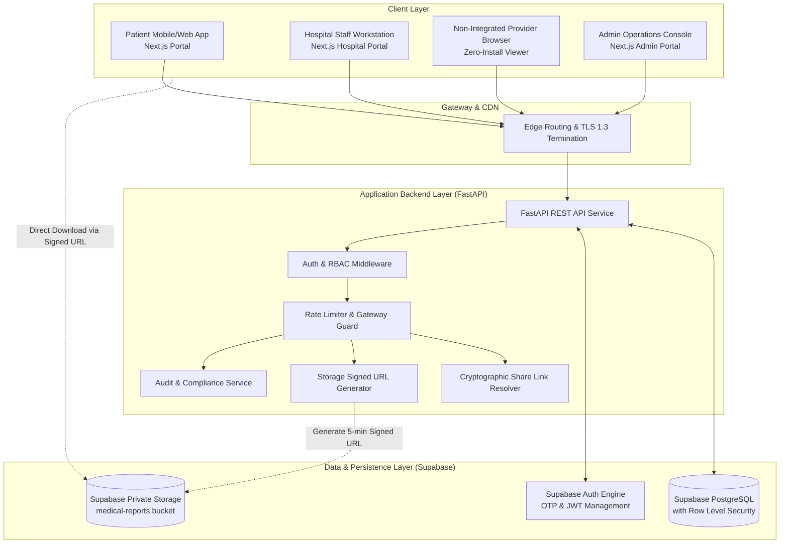
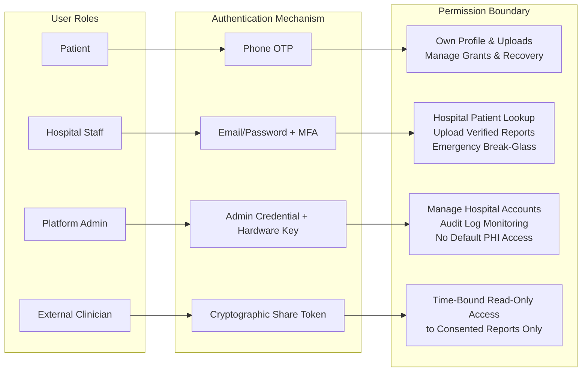
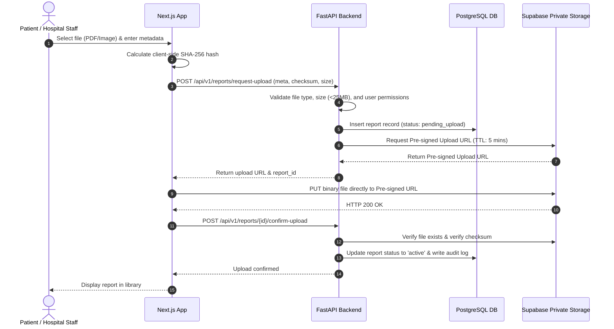
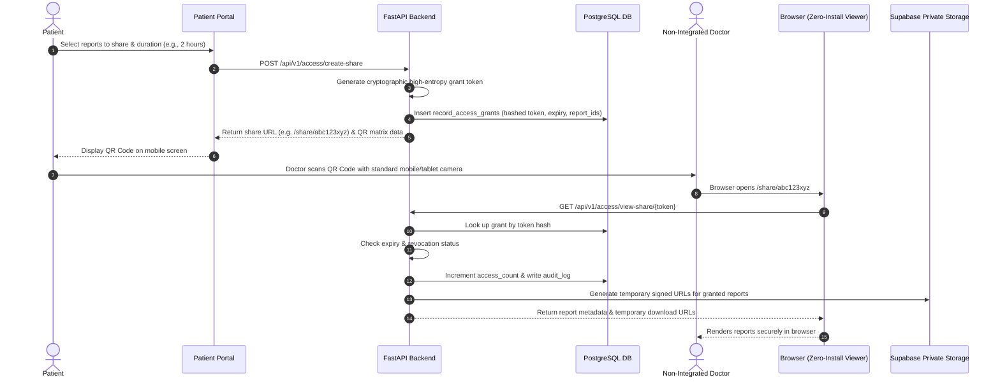
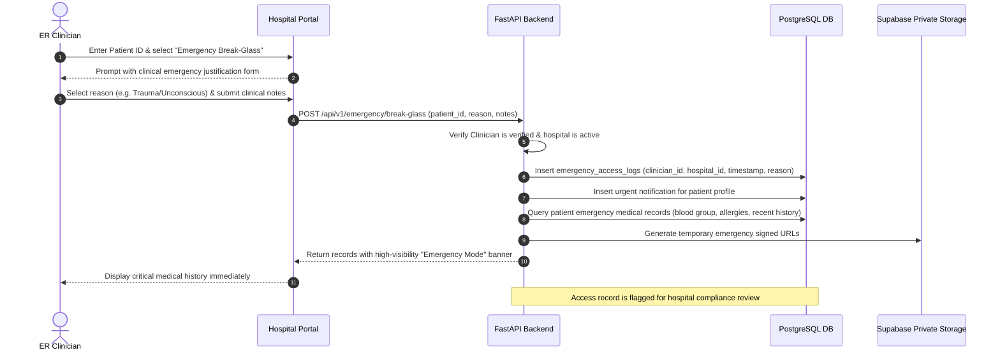

# System Architecture Document
## Patient Medical Report Management System

**Version:** 1.0.0-draft  
**Last Updated:** October 2026  

---

## 1. Architectural Overview

The system employs a decoupled, multi-tiered architecture with a Next.js frontend, a FastAPI Python backend service, and a managed Supabase infrastructure providing PostgreSQL with Row-Level Security (RLS) and encrypted object storage.



---

## 2. Frontend Architecture (Next.js & TypeScript)

The frontend uses Next.js with the **App Router**, structured into isolated route groups to guarantee separation of concerns between different user personas:

### 2.1 Route Groups & Layouts
- **`(patient)`**: Accessible only by authenticated patients.
  - `/patient/dashboard`: Summary of recent reports, active shares, and unique Patient ID card.
  - `/patient/reports`: Filterable medical report library (categorized by lab, radiology, prescription, etc.).
  - `/patient/upload`: Self-upload interface with client-side SHA-256 calculation and format validation.
  - `/patient/share`: QR code generation, active link management, access frequency tracking, and instant revocation.
  - `/patient/recovery`: Account recovery and phone update request flows.
- **`(hospital)`**: Accessible by authorized hospital staff.
  - `/hospital/login`: Organization-scoped clinician and staff login.
  - `/hospital/lookup`: Patient lookup via unique Patient ID with identity confirmation modal.
  - `/hospital/patient/[id]`: Medical report viewer with audit trail indicator.
  - `/hospital/upload`: Direct report upload with mandatory patient attribution and laboratory verification tag.
  - `/hospital/emergency`: Dedicated emergency break-glass triage interface.
- **`(admin)`**: Accessible by platform compliance officers.
  - `/admin/hospitals`: Hospital onboarding, verification, and deactivation.
  - `/admin/audit`: System-wide access log inspection and compliance alerting.
  - *Strict Rule*: Administrators cannot view patient medical files unless accompanied by a legally verified warrant and recorded audit entry.
- **`share/[token]`**: Public, zero-install viewer.
  - Accessible via expiring cryptographic token link or scanned QR code.
  - Displays only patient-consented documents; requires zero registration or app installation from the receiving doctor.

---

## 3. Backend Architecture (FastAPI & Python 3.12)

FastAPI acts as the secure intermediary and business logic enforcement engine:

```text
backend/app/
├── main.py              # Application lifecycle, CORS, exception handlers
├── core/
│   ├── config.py        # Environment variables validation via Pydantic BaseSettings
│   ├── security.py      # JWT decode, token hashing, role verification
│   └── database.py      # Supabase client initialization & session management
├── api/
│   └── v1/
│       ├── health.py    # Liveness and readiness probes
│       ├── patients.py  # Patient registration, de-duplication, and profile APIs
│       ├── reports.py   # Report metadata ingestion & signed upload/download URLs
│       ├── access.py    # Revocable QR grant issuance, access checks, revocation
│       ├── emergency.py # Break-glass emergency authorization & audit logging
│       └── hospital.py  # Hospital staff verification & patient record lookup
└── models/
    └── schemas.py       # Pydantic request/response models with strict type validation
```

### Key Responsibilities of the Backend:
1. **Token Authentication & Role Verification**: Verifies JWTs issued by Supabase Auth and validates user permissions against `users` and `hospital_staff` records.
2. **Access Control Enforcement**: Enforces that staff can only access records if authorized by hospital tenancy, active patient grant, or documented emergency override.
3. **Short-Lived Signed URL Issuance**: Coordinates with Supabase Storage to issue expiring URLs (e.g., 300 seconds), ensuring patient files are never exposed via permanent or public URLs.
4. **Audit Log Dispatch**: Synchronously writes audit entries to `audit_logs` and `emergency_access_logs` for every read, share, and upload action.

---

## 4. Database & Storage Boundaries (Supabase)

### 4.1 Database Layer (PostgreSQL)
- **Engine**: PostgreSQL 15+ managed by Supabase.
- **Security Boundaries**:
  - Direct database access from frontend client is restricted via strict Row-Level Security (RLS) policies.
  - Backend uses a scoped service role connection for administrative logging and emergency workflows, applying application-layer access controls.
- **Data Protection**:
  - Sensitive identifiers (like national IDs/Aadhaar) are never stored as plain text. Only cryptographic references and masked representations are retained.
  - Audit logs are append-only; update and delete operations are restricted via database triggers.

### 4.2 Storage Layer (Private S3-Compatible Buckets)
- **Bucket**: `medical-reports` (configured as private, non-public).
- **Naming Convention**: `reports/{patient_id}/{report_category}/{report_uuid}.{ext}`
- **Access Policy**:
  - Direct public access is disabled.
  - Read access requires an authenticated API call that generates a signed URL with a maximum 5-minute time-to-live (TTL).
  - Write access uses backend-generated pre-signed upload URLs with file size and MIME-type restrictions.

---

## 5. Security & Authorization Boundaries



---

## 6. Core Data Flow Workflows

### 6.1 Report Upload Workflow (Hospital Staff or Patient)



### 6.2 Patient-Authorized Share via QR Code Workflow



### 6.3 Emergency Break-Glass Workflow


