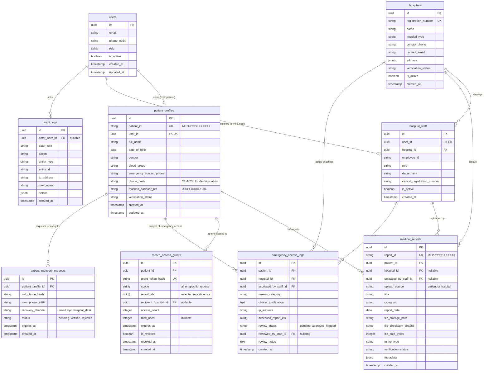

# Database Schema Specification
## Patient Medical Report Management System

**Version:** 1.0.0-draft  
**Target Engine:** PostgreSQL 15+ (Supabase)  
**Schema:** `public`  

---

## 1. Entity-Relationship Diagram



---

## 2. Table Definitions & Constraints

### 2.1 `users`
Acts as the central user account mapping table (mirrored/coordinated with Supabase `auth.users`).
- **`id`** (`UUID`, PK): Matches the Supabase Auth UID.
- **`email`** (`VARCHAR(255)`, NULLABLE, UNIQUE): Optional for patients; mandatory for hospital staff/admins.
- **`phone_e164`** (`VARCHAR(20)`, NULLABLE): Primary authentication credential for patients.
- **`role`** (`VARCHAR(32)`, NOT NULL): Enum (`'patient'`, `'hospital_staff'`, `'platform_admin'`).
- **`is_active`** (`BOOLEAN`, DEFAULT `TRUE`): Soft-disabling mechanism.
- **`created_at`** (`TIMESTAMPTZ`, DEFAULT `NOW()`).
- **`updated_at`** (`TIMESTAMPTZ`, DEFAULT `NOW()`).

### 2.2 `patient_profiles`
Stores the permanent identity of the patient.
- **`id`** (`UUID`, PK, DEFAULT `gen_random_uuid()`): Internal system UUID.
- **`patient_id`** (`VARCHAR(32)`, UNIQUE, NOT NULL): Stable, human-readable external identifier (e.g., `MED-2026-894102`).
- **`user_id`** (`UUID`, UNIQUE, NOT NULL, FK -> `users(id)`): One-to-one link with authentication account.
- **`full_name`** (`VARCHAR(150)`, NOT NULL).
- **`date_of_birth`** (`DATE`, NOT NULL).
- **`gender`** (`VARCHAR(20)`, NOT NULL): `'male'`, `'female'`, `'other'`, `'prefer_not_to_say'`.
- **`blood_group`** (`VARCHAR(5)`, NULLABLE): e.g., `'O+'`, `'A-'`, `'B+'`.
- **`emergency_contact_phone`** (`VARCHAR(20)`, NULLABLE).
- **`phone_hash`** (`VARCHAR(64)`, NOT NULL): SHA-256 hash of normalized phone number for collision and de-duplication checks.
- **`masked_aadhaar_ref`** (`VARCHAR(20)`, NULLABLE): e.g., `'XXXX-XXXX-8921'`. Plain Aadhaar is strictly never stored.
- **`verification_status`** (`VARCHAR(32)`, DEFAULT `'unverified'`): `'unverified'`, `'phone_verified'`, `'kyc_verified'`.
- **`created_at`** (`TIMESTAMPTZ`, DEFAULT `NOW()`).
- **`updated_at`** (`TIMESTAMPTZ`, DEFAULT `NOW()`).

### 2.3 `hospitals`
Stores verified healthcare institutions.
- **`id`** (`UUID`, PK, DEFAULT `gen_random_uuid()`).
- **`registration_number`** (`VARCHAR(100)`, UNIQUE, NOT NULL): Official state/national healthcare registry ID.
- **`name`** (`VARCHAR(255)`, NOT NULL).
- **`hospital_type`** (`VARCHAR(50)`, NOT NULL): `'clinic'`, `'general_hospital'`, `'diagnostic_lab'`, `'multi_specialty'`.
- **`contact_phone`** (`VARCHAR(20)`, NOT NULL).
- **`contact_email`** (`VARCHAR(255)`, NOT NULL).
- **`address`** (`JSONB`, NOT NULL): `{ "street": "...", "city": "...", "state": "...", "pincode": "..." }`.
- **`verification_status`** (`VARCHAR(32)`, DEFAULT `'pending'`): `'pending'`, `'verified'`, `'suspended'`.
- **`is_active`** (`BOOLEAN`, DEFAULT `TRUE`).
- **`created_at`** (`TIMESTAMPTZ`, DEFAULT `NOW()`).

### 2.4 `hospital_staff`
Links hospital staff accounts to verified hospital organizations.
- **`id`** (`UUID`, PK, DEFAULT `gen_random_uuid()`).
- **`user_id`** (`UUID`, UNIQUE, NOT NULL, FK -> `users(id)`).
- **`hospital_id`** (`UUID`, NOT NULL, FK -> `hospitals(id)`).
- **`employee_id`** (`VARCHAR(100)`, NOT NULL).
- **`role`** (`VARCHAR(50)`, NOT NULL): `'clinician'`, `'radiologist'`, `'lab_technician'`, `'records_clerk'`, `'administrator'`.
- **`department`** (`VARCHAR(100)`, NOT NULL).
- **`clinical_registration_number`** (`VARCHAR(100)`, NULLABLE): Medical Council / Dental / Nursing registration number.
- **`is_active`** (`BOOLEAN`, DEFAULT `TRUE`).
- **`created_at`** (`TIMESTAMPTZ`, DEFAULT `NOW()`).

### 2.5 `medical_reports`
Stores metadata and object-store references for diagnostic records.
- **`id`** (`UUID`, PK, DEFAULT `gen_random_uuid()`).
- **`report_id`** (`VARCHAR(32)`, UNIQUE, NOT NULL): e.g., `REP-2026-471092`.
- **`patient_id`** (`UUID`, NOT NULL, FK -> `patient_profiles(id)`).
- **`hospital_id`** (`UUID`, NULLABLE, FK -> `hospitals(id)`): Populated when uploaded by an integrated hospital.
- **`uploaded_by_staff_id`** (`UUID`, NULLABLE, FK -> `hospital_staff(id)`): Populated if uploaded by hospital staff.
- **`upload_source`** (`VARCHAR(20)`, NOT NULL): `'patient'` or `'hospital'`.
- **`title`** (`VARCHAR(255)`, NOT NULL): e.g., "Complete Blood Count (CBC)".
- **`category`** (`VARCHAR(50)`, NOT NULL): `'blood_test'`, `'xray'`, `'ct_scan'`, `'mri'`, `'prescription'`, `'discharge_summary'`, `'other'`.
- **`report_date`** (`DATE`, NOT NULL): Date the clinical test or consultation occurred.
- **`file_storage_path`** (`TEXT`, NOT NULL): Internal bucket reference (e.g., `reports/uuid/path/file.pdf`).
- **`file_checksum_sha256`** (`VARCHAR(64)`, NOT NULL): For data integrity verification.
- **`file_size_bytes`** (`BIGINT`, NOT NULL).
- **`mime_type`** (`VARCHAR(100)`, NOT NULL): e.g., `'application/pdf'`, `'image/jpeg'`.
- **`verification_status`** (`VARCHAR(32)`, DEFAULT `'unverified'`): `'unverified'`, `'hospital_verified'`.
- **`metadata`** (`JSONB`, DEFAULT `'{}'::jsonb`): Optional key-value parameters (e.g. lab parameters, radiologist notes).
- **`created_at`** (`TIMESTAMPTZ`, DEFAULT `NOW()`).

### 2.6 `record_access_grants`
Facilitates time-bound, revocable sharing for non-integrated hospitals, doctors, and QR codes.
- **`id`** (`UUID`, PK, DEFAULT `gen_random_uuid()`).
- **`patient_id`** (`UUID`, NOT NULL, FK -> `patient_profiles(id)`).
- **`grant_token_hash`** (`VARCHAR(64)`, UNIQUE, NOT NULL): SHA-256 hash of the random token issued in the URL/QR code.
- **`scope`** (`VARCHAR(32)`, DEFAULT `'all'`): `'all'` or `'specific_reports'`.
- **`report_ids`** (`UUID[]`, DEFAULT `'{}'::uuid[]`): Populated when scope is `'specific_reports'`.
- **`recipient_hospital_id`** (`UUID`, NULLABLE, FK -> `hospitals(id)`).
- **`access_count`** (`INTEGER`, DEFAULT 0): Incremented on each verified retrieval.
- **`max_uses`** (`INTEGER`, NULLABLE): Optional cap on views.
- **`expires_at`** (`TIMESTAMPTZ`, NOT NULL): Strict expiration timestamp.
- **`is_revoked`** (`BOOLEAN`, DEFAULT `FALSE`): Instant revocation trigger.
- **`revoked_at`** (`TIMESTAMPTZ`, NULLABLE).
- **`created_at`** (`TIMESTAMPTZ`, DEFAULT `NOW()`).

### 2.7 `emergency_access_logs`
Audit and compliance table for emergency break-glass actions.
- **`id`** (`UUID`, PK, DEFAULT `gen_random_uuid()`).
- **`patient_id`** (`UUID`, NOT NULL, FK -> `patient_profiles(id)`).
- **`hospital_id`** (`UUID`, NOT NULL, FK -> `hospitals(id)`).
- **`accessed_by_staff_id`** (`UUID`, NOT NULL, FK -> `hospital_staff(id)`).
- **`reason_category`** (`VARCHAR(50)`, NOT NULL): e.g., `'unconscious_patient'`, `'trauma_resuscitation'`, `'acute_cardiac_arrest'`.
- **`clinical_justification`** (`TEXT`, NOT NULL): Mandatory text entered by clinician before access is granted.
- **`ip_address`** (`VARCHAR(45)`, NOT NULL).
- **`accessed_report_ids`** (`UUID[]`, DEFAULT `'{}'::uuid[]`).
- **`review_status`** (`VARCHAR(32)`, DEFAULT `'pending'`): `'pending'`, `'reviewed_compliant'`, `'flagged_audit'`.
- **`reviewed_by_staff_id`** (`UUID`, NULLABLE, FK -> `hospital_staff(id)`).
- **`review_notes`** (`TEXT`, NULLABLE).
- **`created_at`** (`TIMESTAMPTZ`, DEFAULT `NOW()`).

### 2.8 `patient_recovery_requests`
Maintains safe account recovery when a patient's mobile number changes without creating duplicate profiles.
- **`id`** (`UUID`, PK, DEFAULT `gen_random_uuid()`).
- **`patient_profile_id`** (`UUID`, NOT NULL, FK -> `patient_profiles(id)`).
- **`old_phone_hash`** (`VARCHAR(64)`, NOT NULL).
- **`new_phone_e164`** (`VARCHAR(20)`, NOT NULL).
- **`recovery_channel`** (`VARCHAR(50)`, NOT NULL): `'email_challenge'`, `'hospital_desk'`, `'identity_doc'`.
- **`status`** (`VARCHAR(32)`, DEFAULT `'pending'`): `'pending'`, `'verified'`, `'rejected'`.
- **`expires_at`** (`TIMESTAMPTZ`, NOT NULL).
- **`created_at`** (`TIMESTAMPTZ`, DEFAULT `NOW()`).

### 2.9 `audit_logs`
Immutable compliance and activity record.
- **`id`** (`UUID`, PK, DEFAULT `gen_random_uuid()`).
- **`actor_user_id`** (`UUID`, NULLABLE, FK -> `users(id)`).
- **`actor_role`** (`VARCHAR(50)`, NOT NULL).
- **`action`** (`VARCHAR(100)`, NOT NULL): e.g., `'view_report'`, `'share_created'`, `'report_downloaded'`, `'revoked_grant'`.
- **`entity_type`** (`VARCHAR(50)`, NOT NULL): `'medical_report'`, `'patient_profile'`, `'access_grant'`.
- **`entity_id`** (`VARCHAR(100)`, NOT NULL).
- **`ip_address`** (`VARCHAR(45)`, NOT NULL).
- **`user_agent`** (`TEXT`, NULLABLE).
- **`details`** (`JSONB`, DEFAULT `'{}'::jsonb`).
- **`created_at`** (`TIMESTAMPTZ`, DEFAULT `NOW()`).

---

## 3. High-Performance Indexing Strategy

```sql
-- Fast patient lookups
CREATE INDEX idx_patient_profiles_patient_id ON patient_profiles(patient_id);
CREATE INDEX idx_patient_profiles_phone_hash ON patient_profiles(phone_hash);
CREATE INDEX idx_patient_profiles_user_id ON patient_profiles(user_id);

-- Report queries by patient and category
CREATE INDEX idx_medical_reports_patient_id ON medical_reports(patient_id);
CREATE INDEX idx_medical_reports_category ON medical_reports(patient_id, category);
CREATE INDEX idx_medical_reports_created_at ON medical_reports(created_at DESC);

-- Fast token lookup for shared links
CREATE INDEX idx_record_access_grants_token ON record_access_grants(grant_token_hash) 
WHERE is_revoked = FALSE;

-- Hospital staff association
CREATE INDEX idx_hospital_staff_user ON hospital_staff(user_id);
CREATE INDEX idx_hospital_staff_hospital ON hospital_staff(hospital_id);

-- Emergency access audit lookup
CREATE INDEX idx_emergency_access_patient ON emergency_access_logs(patient_id, created_at DESC);
CREATE INDEX idx_audit_logs_actor ON audit_logs(actor_user_id, created_at DESC);
CREATE INDEX idx_audit_logs_entity ON audit_logs(entity_type, entity_id);
```

---

## 4. Row-Level Security (RLS) Principles

1. **Patient Isolation**: Patients can only select and modify records where `patient_profiles.user_id = auth.uid()`.
2. **Hospital Tenancy Isolation**: Hospital staff can only view reports where `medical_reports.hospital_id = staff.hospital_id` unless an active grant or emergency session applies.
3. **Immutability of Audit Trails**: `audit_logs` and `emergency_access_logs` allow `INSERT` only. `UPDATE` and `DELETE` are disallowed to protect audit integrity.
